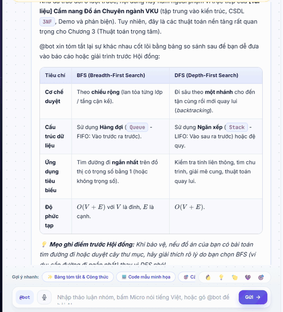
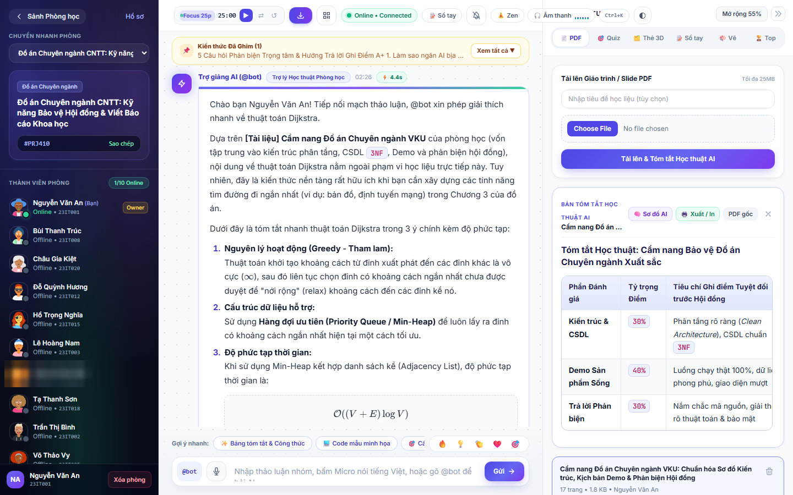
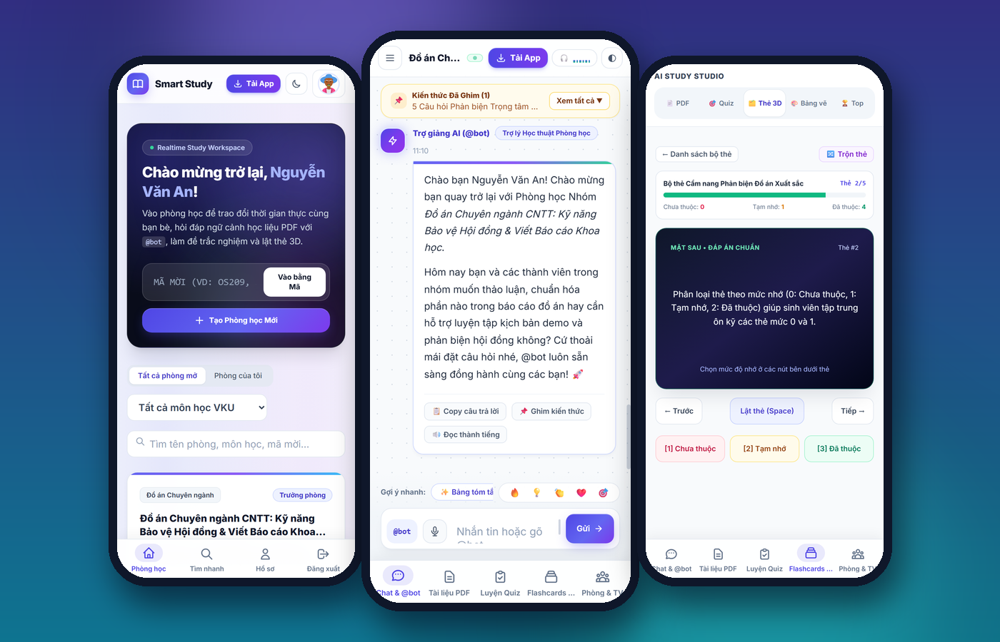

<div align="center">

<a href="https://github.com/Annguyen04-06">
  
</a>

### 👨‍💻 Tác giả: **Nguyễn An** · [@Annguyen04-06](https://github.com/Annguyen04-06)
<sub>Đồ án Chuyên ngành 4 (DACS4) — thiết kế, lập trình và triển khai toàn bộ hệ thống</sub>

<br/>



<br/>


<br/>


**Phòng học nhóm trực tuyến có Trợ giảng AI `@bot` trả lời dạng stream từng chữ, đọc hiểu giáo trình PDF,<br/>sinh đề trắc nghiệm, thẻ ghi nhớ 3D và đồng bộ tức thì giữa Laptop ⇄ Điện thoại.**

[✨ Điểm nổi bật](#-điểm-nổi-bật) · [🎬 Demo](#-demo-thực-tế) · [⚡ Hiệu năng](#-hiệu-năng-đo-thực-tế) · [🧩 Kiến trúc](#-kiến-trúc) · [🚀 Chạy thử](#-chạy-thử-trong-3-bước)

</div>

---

## ✨ Điểm nổi bật

<table>
<tr>
<td width="50%" valign="top">

### 🤖 Trợ giảng `@bot` Streaming
Gõ `@bot` trong phòng chat là Gemini trả lời **từng chữ như ChatGPT**, bám sát học liệu PDF của phòng, hiển thị **Markdown, bảng, công thức KaTeX, code highlight** và huy hiệu ⚡ tốc độ phản hồi.

</td>
<td width="50%" valign="top">

### ⚡ Thời gian thực với SignalR
Chat nhóm, ai đang online, ai đang gõ, **bảng trắng vẽ chung có con trỏ**, **Pomodoro đồng bộ cả phòng**, ghim kiến thức, thả cảm xúc — tất cả cập nhật tức thì.

</td>
</tr>
<tr>
<td valign="top">

### 📚 AI Study Studio
Tải giáo trình PDF → AI **tóm tắt**, sinh **đề trắc nghiệm** có đồng hồ & bảng xếp hạng, **Flashcards 3D** lặp lại ngắt quãng, **sơ đồ tư duy** và **radar điểm yếu** cá nhân.

</td>
<td valign="top">

### 📱 PWA như App thật
Cài 1 chạm trên Android/iPhone, giao diện native dưới 768px (Bottom Navigation, vuốt thẻ, Safe Area), **chạy offline** với IndexedDB và **tự cập nhật OTA** khi có bản mới.

</td>
</tr>
<tr>
<td valign="top">

### 🚀 Optimistic UI & Delta Sync
Tin nhắn, ghim, emoji, chấm thẻ **hiện ngay 0ms**, lỗi thì tự hoàn tác. Mở lại App trên điện thoại chỉ tải **phần tin nhắn còn thiếu**.

</td>
<td valign="top">

### 🌐 Server 24/7 ngay trên Laptop
Watchdog chạy ngầm tự hồi phục dịch vụ, **Cloudflare HTTPS Tunnel** + nút **QR "Mở trên Điện thoại"**, tự khởi động cùng Windows — không cần quyền Admin.

</td>
</tr>
</table>

## 🎬 Demo thực tế

<div align="center">

**`@bot` trả lời dạng stream ngay trong phòng học** <sub>(quay màn hình thật)</sub>



<br/><br/>

**Không gian học tập 3 cột trên Laptop**



<br/><br/>

**Giao diện Native trên điện thoại** — Sảnh phòng học · Chat & `@bot` · Flashcards 3D



<br/><br/>

**Trang giới thiệu**


</div>

## ⚡ Hiệu năng đo thực tế

| Chỉ số | Trước tối ưu | Sau tối ưu |
|---|:---:|:---:|
| `@bot` hiện chữ đầu tiên | ~15 s (chờ trọn câu) | **~1 – 1.5 s** ¹ |
| `@bot` trả lời hoàn chỉnh | ~15 s | **~2 – 4 s** ¹ |
| Hiện tin nhắn vừa gửi | chờ máy chủ | **0 ms** (Optimistic UI) |
| Dung lượng HTML / JS / CSS | 100% | **giảm 66 – 75%** (Brotli) |
| Dịch vụ bị tắt đột ngột | khởi động lại thủ công | **tự hồi phục ~7 – 11 s** |

<sub>¹ Đo bằng trình duyệt thật với Gemini Flash. Giờ cao điểm máy chủ Google có thể chậm hơn — hệ thống tự né model đang quá tải hoặc hết hạn mức, luồng lỗi giữa chừng tự chuyển sang chế độ trả lời thường nên `@bot` không bao giờ im lặng.</sub>

## 🧩 Kiến trúc

<div align="center">

</div>

| Tầng | Công nghệ | Vai trò |
|---|---|---|
| **Frontend** | HTML5 · Tailwind CSS · Vanilla ES6 Modules (API – View – Controller) | Giao diện PWA, không bundler |
| **Backend Core** | ASP.NET Core 8 · SignalR · EF Core 8 · JWT · FluentValidation | Clean Architecture 4 lớp, phục vụ cả API lẫn giao diện |
| **AI Service** | Python FastAPI · `google-genai` · Pydantic v2 · pdfplumber | Bóc tách PDF, Structured Output cho Quiz/Flashcards, Streaming SSE |
| **Database** | Microsoft SQL Server | 12 bảng chuẩn 3NF |
| **Vận hành** | PowerShell Watchdog · Cloudflare Tunnel · Docker Compose · Caddy | Chạy 24/7 trên Laptop hoặc VPS có HTTPS |

## 🚀 Chạy thử trong 3 bước

> Cần **.NET 8 SDK**, **Python 3.11+** và **SQL Server Express** (`localhost\SQLEXPRESS`). Khóa Gemini là tùy chọn — không có vẫn chạy chế độ trích xuất PDF cục bộ.

```bat
:: 1) Khai báo khóa Gemini (tùy chọn)
copy ai-service\.env.example ai-service\.env

:: 2) Cài thư viện cho AI Service
cd ai-service && python -m venv .venv && .venv\Scripts\pip install -r requirements.txt && cd ..

:: 3) Bật toàn hệ thống chạy ngầm (Backend + AI + HTTPS Tunnel), rồi mở http://localhost:5500
scripts\start-app.bat
```

Cơ sở dữ liệu và dữ liệu mẫu được tạo tự động ở lần chạy đầu. Muốn mở trên điện thoại: bấm nút **QR** trên thanh điều hướng.
Chạy bằng Docker, triển khai VPS, tài khoản demo và toàn bộ API: xem **[Hướng dẫn kỹ thuật chi tiết](docs/HUONG-DAN-CHI-TIET.md)** · **[Triển khai VPS](docs/PRODUCTION_VPS_AND_SYNC_GUIDE.md)**.

<details>
<summary><b>📂 Cấu trúc thư mục</b></summary>

```text
├── frontend/          # PWA: pages/, src/core (config, http, realtime, sync), src/features/*, src/shared
├── backend-core/      # SmartStudy.Domain · .Application · .Infrastructure · .API + Unit Tests (xUnit)
├── ai-service/        # FastAPI: api/v1/endpoints, services, prompts, schemas, core
├── database/          # Script SQL Server: bảng, ràng buộc, dữ liệu mẫu
├── scripts/           # local-vps (daemon 24/7 + tunnel), background-service, pwa, build-release
├── deploy/vps/        # Docker Compose production + Caddy HTTPS
└── docs/              # Hướng dẫn chi tiết + hình ảnh README
```

</details>

---

<div align="center">

### 👨‍💻 Tác giả

<a href="https://github.com/Annguyen04-06"></a>

**Nguyễn An** — [@Annguyen04-06](https://github.com/Annguyen04-06)

Nếu dự án hữu ích, hãy tặng một ⭐ để ủng hộ tác giả nhé!


</div>
