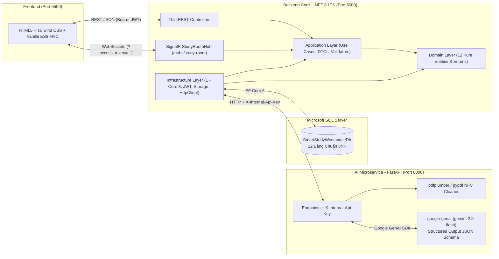
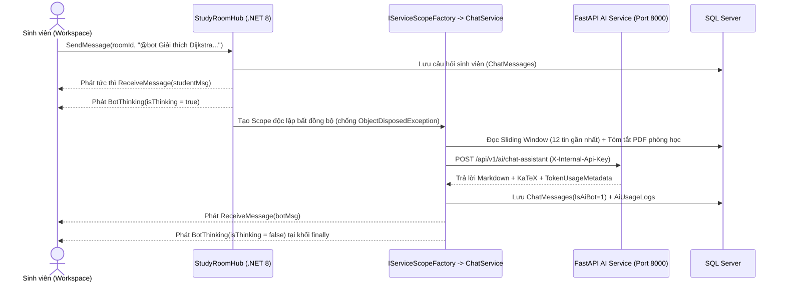

# Smart Study Workspace — Hướng dẫn Kỹ thuật Chi tiết

**Nền tảng Học tập Nhóm Thông minh Tích hợp Trợ giảng AI (`@bot`) và Tương tác Thời gian thực**

Hệ thống được thiết kế theo mô hình **Monorepo Phân tầng Chuẩn mực (4-Tier Architecture)** phục vụ bảo vệ Đồ án Chuyên ngành / Khóa luận Công nghệ Thông tin, đảm bảo nguyên tắc **Strict Separation of Concerns (SoC)**, **SOLID**, **Zero Placeholders** và luồng tích hợp thực tế 100% từ giao diện đến cơ sở dữ liệu và Google Gemini AI.

---

## 1. Kiến trúc Tổng thể Hệ thống (System Topology)



### Luồng Thời gian thực Trợ giảng `@bot` (SignalR + Sliding Window + Grounding PDF)



---

## 2. Cấu trúc Thư mục Monorepo

| Thành phần | Cổng | Công nghệ Chủ đạo | Vai trò Kiến trúc |
| :--- | :---: | :--- | :--- |
| **`/database`** | `1433` | T-SQL (SQL Server) | 3 script chuẩn hóa 3NF: `01_schema_tables.sql` (12 bảng), `02_indexes_constraints.sql`, `03_seed_data.sql`. |
| **`/ai-service`** | `8000` | Python 3.11+, FastAPI, `google-genai`, `pdfplumber`, `pypdf` | Bóc tách PDF tiếng Việt chuẩn Unicode NFC, hỏi đáp ngữ cảnh `@bot`, sinh Quiz & Flashcards bằng Pydantic v2 `response_schema`. |
| **`/backend-core`** | `5000` | ASP.NET Core 8 Web API, SignalR, EF Core 8, FluentValidation, BCrypt, xUnit | Clean Architecture 4 tầng (`Domain`, `Application`, `Infrastructure`, `API`) + `SmartStudy.UnitTests`. |
| **`/frontend`** | `5500` | HTML5, Tailwind CSS CDN, Vanilla ES6 Modules, SignalR JS, KaTeX, Highlight.js, Chart.js | Kiến trúc Feature-Sliced MVC (`*.api.js` — `*.view.js` — `*.controller.js`), giao diện 3-Pane Workspace & Admin Portal. |

---

## 3. Danh sách 12 Bảng Cơ sở Dữ liệu Chuẩn 3NF

1. **`Users`**: Quản lý Sinh viên (`StudentCode` Unique Filtered Index) và Quản trị viên (`Role`: `Admin` | `Student`).
2. **`StudyRooms`**: Không gian phòng học nhóm kèm mã mời duy nhất `InviteCode` và trạng thái `Pending` | `Active` | `Closed`.
3. **`RoomMembers`**: Bảng trung gian phân quyền `Owner` | `Member` với Composite Unique Index `(RoomId, UserId)`.
4. **`ChatMessages`**: Tin nhắn thảo luận thời gian thực (`BIGINT` PK) & phản hồi `@bot`, tối ưu Index `(RoomId, CreatedAt DESC)`.
5. **`CourseMaterials`**: Lưu trữ đường dẫn PDF vật lý, văn bản trích xuất `ExtractedText` và bản tóm tắt học thuật `AiSummary`.
6. **`Quizzes`**: Đề thi trắc nghiệm sinh tự động theo độ khó (`Easy` | `Medium` | `Hard`) và thời lượng làm bài.
7. **`QuizQuestions`**: Ngân hàng câu hỏi 4 phương án (`A/B/C/D`) kèm giải thích học thuật `Explanation`.
8. **`QuizAttempts`**: Lịch sử làm bài của sinh viên với điểm số thang 10 (`DECIMAL(5,2)`) và thời gian hoàn thành.
9. **`QuizAttemptAnswers`**: Chi tiết phương án đã chọn cho từng câu trong mỗi lượt thi.
10. **`FlashcardDecks`**: Bộ thẻ ghi nhớ trích xuất từ học liệu PDF của phòng học.
11. **`Flashcards`**: Thẻ học 2 mặt tích hợp 3 mức độ nhớ Spaced Repetition (`0 = Chưa thuộc`, `1 = Tạm nhớ`, `2 = Đã thuộc`).
12. **`AiUsageLogs`**: Nhật ký đo đếm `PromptTokens`, `CompletionTokens`, `TotalTokens`, `DurationMs` phục vụ biểu đồ Quản trị viên.

> **Giải pháp chống lỗi Multiple Cascade Paths trên SQL Server:** Toàn bộ khóa ngoại trỏ về `Users` và `CourseMaterials` từ bảng con đều được cấu hình `DeleteBehavior.Restrict` / `DeleteBehavior.NoAction` đồng bộ giữa EF Core `IEntityTypeConfiguration<T>` và script DDL SQL.

---

## 4. Tính năng Sáng tạo Đột phá (Breakthrough Features)

1. **Đồng hồ Học Nhóm Đồng bộ Thời gian thực (Real-time Group Pomodoro):** Đồng bộ giây đếm ngược 25p Tập trung / 5p Giải lao cho mọi thành viên trong phòng qua SignalR (`StartPomodoro`, `PausePomodoro`, `ResetPomodoro` → `PomodoroStateUpdated`), phát chuông Web Audio API khi hoàn thành phiên.
2. **Bảng xếp hạng Thi đua Phòng học (Room Leaderboard):** Xếp hạng tự động theo Điểm Quiz cao nhất, Số đề hoàn thành và Thời gian làm bài nhanh nhất với vương miện Vàng / Bạc / Đồng.
3. **Ghim Kiến thức Vàng (Pinned Messages & AI Insights):** Cho phép ghim các câu trả lời xuất sắc của `@bot` lên thanh Pinned Banner ngay dưới Header phòng học và đồng bộ tức thì qua SignalR (`MessagePinUpdated`).
4. **Command Palette (`Ctrl+K`) + Nhập liệu Giọng nói Tiếng Việt (`vi-VN`) + Xuất Đề cương Ôn tập PDF:** Tìm kiếm nhanh kiểu Spotlight, đọc giọng nói thành câu lệnh `@bot`, đọc to câu trả lời (`speechSynthesis`) và in phiếu tóm tắt học thuật sạch đẹp.
5. **Trình hiển thị Học thuật `.ai-prose` & Dual-Mode Gemini/Vertex SDK:** Bảo vệ công thức KaTeX (`$$...$$`, `$...$`), bảng cuộn ngang `.ai-table-wrapper`, khung mã nguồn kiểu macOS IDE có nút `Copy code`, giao diện **Dark / Light Mode** mượt mà (`startViewTransition`), và tự động nhận diện cả khóa `AQ.*` (Vertex AI Express) lẫn `AIza*` (Google AI Studio).
6. **Phân tích Lỗ hổng Kiến thức & Lộ trình Ôn tập AI (`AI Smart Weakness Radar`):** Tổng hợp toàn bộ các câu trả lời sai từ bảng `QuizAttemptAnswers` gửi sang Gemini 2.5 Flash Structured Output (`POST /api/quizzes/analyze-weakness`), hiển thị biểu đồ Radar năng lực theo môn, chẩn đoán đúng 3 lỗ hổng kiến thức trọng yếu nhất và nút **1-Click "Tạo ngay đề Quiz 5 câu vá lỗ hổng"**.
7. **Sổ tay Ghi chú Học tập Chia đôi Màn hình (`Personal Markdown Scratchpad`) & Chế độ Offline-First IndexedDB:** Sổ tay Markdown/KaTeX riêng cho từng phòng học lưu tức thì vào IndexedDB, hỗ trợ nút **"📝 Lưu vào Sổ tay"** trên mọi câu trả lời của `@bot` và xuất file `.md` / in PDF 1 chạm. Khi mất mạng, sinh viên vẫn lật thẻ 3D Flashcards (tự đồng bộ `Sync Queue` khi có mạng lại), đọc lời giải Quiz và tóm tắt PDF đã lưu.
8. **Thông báo Đẩy Hệ điều hành (`Web Notifications API`) & Đồng bộ Giao diện Tự động (`OTA Auto-Sync Engine`):** Bắn thông báo góc màn hình kèm âm thanh khi `@bot` trả lời xong hoặc Pomodoro hết giờ; tự động phát hiện bản build mới trên máy chủ qua `GET /api/system/version` để xóa cache cũ và đồng bộ giao diện mới trên mọi Laptop/Điện thoại trong 1.2 giây.

---

## 5. Đóng gói Ứng dụng PWA & Hướng dẫn Vận hành Nhanh (Packaging & Deployment)

Hệ thống hỗ trợ 3 phương thức vận hành chuẩn sản xuất đáp ứng cả phát triển cục bộ, chấm điểm đồ án 1-click và triển khai Container hóa:

### Phương thức 1: Khởi động 1-Click trên Windows (`/scripts`)
Không cần gõ lệnh thủ công, chỉ cần thực thi các file kịch bản tự động trong thư mục `/scripts`:
- **`scripts/start-app.bat`**: Bật hệ thống **chạy ngầm 24/7** (không mở cửa sổ đen nào): Backend C# All-in-One phục vụ giao diện + API + SignalR trên **cả cổng 5000 và 5500**, AI Service cổng 8000 (nội bộ). Chờ tới khi sẵn sàng rồi mở `http://localhost:5500`. Đóng cửa sổ/terminal **không** làm web ngừng.
- **`scripts/stop-app.bat`**: Tắt sạch Watchdog, Backend, AI Service (và Cloudflare Tunnel nếu đang mở), giải phóng cổng 5000/5500/8000.
- **`scripts/build-release.ps1`**: Đóng gói tự động toàn bộ Solution thành thư mục phát hành độc lập `/release-package` (gồm Backend đã `dotnet publish -c Release`, Frontend PWA, AI Service, Database DDL và script chạy).

### Phương thức 2: Triển khai Microservices Bằng Docker Compose
Toàn bộ hệ thống được container hóa đầy đủ qua `docker-compose.yml` tại thư mục gốc:
```bash
# 1. Điền khóa Gemini API vào .env (sao chép từ .env.example)
cp .env.example .env

# 2. Khởi chạy toàn bộ 4 dịch vụ (SQL Server 2022, AI Service, .NET 8 Backend, Frontend Nginx)
docker compose up -d --build
```
- Frontend Nginx Web App & Reverse Proxy: `http://localhost` (Cổng 80)
- Backend Core REST API: `http://localhost:5000/api`
- AI Microservice FastAPI: `http://localhost:8000/docs`
- Microsoft SQL Server 2022: Cổng `1433` (Password: `YourStrong@Passw0rd!`)

### Phương thức 3: Cài đặt Web App Dạng PWA (Desktop & Mobile)
- **Nút "Tải App"** luôn hiển thị trên Header (Trang chủ, Sảnh Phòng học, Hồ sơ, Quản trị, Phòng học) khi chưa chạy ở chế độ Standalone:
  - **Android / Windows / macOS (Chrome, Edge):** cài đặt 1 chạm qua `beforeinstallprompt`.
  - **iPhone / iPad (Safari):** mở Bottom Sheet hướng dẫn trực quan 2 bước: **Chia sẻ** $\rightarrow$ **"Thêm vào MH chính"**.
- Cài đặt đầy đủ (Service Worker, toàn màn hình) yêu cầu **HTTPS** hoặc `http://localhost` — dùng link Cloudflare ở Phương thức 4 cho điện thoại.
- **Giao diện Native Mobile (< 768px):** Phòng học chuyển sang Bottom Navigation 5 tab (Chat & @bot • Tài liệu PDF • Luyện Quiz • Flashcards 3D • Phòng & TV), Drawer thành viên trượt từ cạnh trái, vuốt ngang chuyển thẻ Flashcard 3D, hỗ trợ tai thỏ iPhone (Safe Area).
- **Chiến lược cache:** API/SignalR/Uploads luôn đi thẳng ra mạng; giao diện dùng Network-First có dự phòng cache, mất mạng hiển thị `offline.html`.
- Sinh lại bộ icon PWA (mũ tốt nghiệp + tia sáng AI): `ai-service\.venv\Scripts\python.exe scripts\pwa\generate_pwa_icons.py`

### Phương thức 4: Local VPS 24/7 chạy ngầm + Cloudflare HTTPS Tunnel + QR Portal (`/scripts/local-vps`)
Backend C# đóng vai trò **All-in-One Host** trên cổng `5000` **và** `5500`: phục vụ cùng lúc REST API, SignalR Hub, file tải lên và toàn bộ thư mục `/frontend` (tự dò tìm, hoặc cấu hình `FrontendHosting:RootPath`). Frontend dùng chính `window.location.origin` nên không còn lỗi CORS hay Mixed Content.

**Lớp nền chạy ngầm 24/7 (không cần quyền Admin):**
- **`daemon-watchdog.ps1`**: Giám sát mỗi 15 giây, tự khởi động lại AI Service (`127.0.0.1:8000`, log `logs/ai.log`) và Backend (`0.0.0.0:5000;0.0.0.0:5500`, log `logs/backend.log`) khi bị tắt hoặc treo. Backend chạy bản Release đã publish tại `publish-backend/` nên không khóa file khi code. Chống chạy trùng (Mutex) và chống vòng lặp khởi động lại.
- **Cloudflare HTTPS Tunnel trong daemon** (log `logs/tunnel.log`): tự tải `cloudflared.exe`, mở `https://xxxx.trycloudflare.com` -> `127.0.0.1:5500`, kiểm chứng link trả 200 rồi ghi `current-tunnel-url.txt` (ghi lại mỗi 60 giây làm nhịp tim). Cloudflare thu hồi link => tự mở link mới; `redeploy-backend.bat` **giữ nguyên** link. Tên miền cố định: đặt biến môi trường `CLOUDFLARE_TUNNEL_TOKEN` + `CLOUDFLARE_TUNNEL_PUBLIC_URL` (token chỉ truyền qua biến môi trường, không ghi ra log).
- **Nút QR "Mở trên Điện thoại"** (Laptop >= 768px, trên Đăng nhập / Navbar / Phòng học): gọi `GET /api/system/mobile-access` => `{ publicHttpsUrl, lanUrl, isTunnelActive, updatedAt }`, vẽ mã QR ngay trên trình duyệt trỏ đúng trang đang xem. Người truy cập qua Internet không nhận được IP LAN (`lanUrl: null`).
- **`start-silent-background.vbs`**: Bật Watchdog ẩn hoàn toàn (không hiện cửa sổ CMD/PowerShell).
- **`enable-autostart-vps.bat` / `disable-autostart-vps.bat`**: Bật/tắt tự chạy ngầm cùng Windows (`Startup\SmartStudyAutoStart.vbs`).
- **`stop-background.bat`**: Tắt sạch Watchdog, Backend, AI Service, Cloudflare Tunnel để giải phóng RAM.
- **`redeploy-backend.bat`**: Sau khi sửa code C#: tắt -> `dotnet publish -c Release` -> bật lại ngầm. Sửa HTML/JS/CSS thì **không** cần chạy, có hiệu lực ngay.
- **`allow-lan-firewall.bat`** (chạy 1 lần, cần UAC): mở tường lửa cổng 5000/5500 cho điện thoại cùng Wi-Fi (chỉ thiết bị trong cùng mạng con).
- Xem trạng thái: `powershell -ExecutionPolicy Bypass -File scripts\local-vps\daemon-watchdog.ps1 -Status`

**Bật / tắt đường hầm Internet:**
- **`run-local-vps.bat`**: Bật lại đường hầm (xóa cờ `tunnel.disabled`), bảo đảm daemon đang chạy, chờ link HTTPS được kiểm chứng và sinh trang **QR Portal** (mã QR tạo ngay trên trình duyệt). Đóng cửa sổ không ảnh hưởng gì.
- **`stop-local-vps.bat`**: Tắt đường hầm Internet (tạo cờ `tunnel.disabled`); Laptop/LAN vẫn chạy.

**OTA Auto-Sync:** `GET /api/system/version` (`Cache-Control: no-store`) đổi mã phiên bản khi Backend build lại hoặc file giao diện thay đổi; `otaUpdater.service.js` kiểm tra khi mở trang, khi quay lại tab và mỗi 60 giây, rồi xóa Cache Storage và tải lại. Hub SignalR còn đẩy `ServerVersion` mỗi lần kết nối/kết nối lại để đồng bộ ngay. Nếu người dùng đang làm bài thi hoặc đang soạn dở tin nhắn thì hoãn tới khi xong.

**Tốc độ & đồng bộ tức thì:**
- **@bot Streaming thật:** FastAPI `POST /api/v1/ai/chat-assistant-stream` (SSE) -> C# đọc luồng (`ResponseHeadersRead`) -> SignalR `BotStreamStart` / `BotStreamChunk` (gom 50ms) / `BotStreamComplete` (lưu `ChatMessages` + `AiUsageLogs`). Luồng lỗi => tự gọi endpoint thường. Gemini chạy chế độ suy luận tối thiểu, ngữ cảnh gọn (8 tin x 400 ký tự + 2.500 ký tự học liệu liên quan nhất), tự né model đang quá tải/hết hạn mức.
- **Optimistic UI:** gửi tin, ghim, thả cảm xúc, chấm Flashcard hiện ngay 0ms rồi khớp dữ liệu thật; lỗi => tự hoàn tác + Toast.
- **Delta Sync:** mở lại App / có mạng / SignalR kết nối lại => chỉ tải tin mới qua `GET /api/rooms/{id}/messages?afterId=...`.
- **Nén Brotli/Gzip** cho HTML/JS/CSS/JSON (giảm 66–75% dung lượng); SignalR kết nối WebSocket trực tiếp và tự kết nối lại theo nhịp 0 / 0.5 / 1.5 / 3 / 5 giây.

- Kiểm tra sức khỏe: `GET http://localhost:5000/api/health` (trường `data.frontendMounted` cho biết giao diện đã được gắn).
- Lưu ý: link Cloudflare Quick Tunnel **đổi mới khi đường hầm được mở lại** (khởi động máy, `stop-background.bat`, Cloudflare thu hồi) — nút QR trong App luôn hiện link mới nhất; nhật ký nằm ở `scripts/local-vps/logs`.

### Phương thức 5: Production VPS 24/7 (Caddy Auto SSL HTTPS) & Windows Background Service (`/deploy/vps` & `/scripts/background-service`)
- **Production Ubuntu/Debian VPS 24/7:** Gồm 5 container (`sqlserver`, `ai-service`, `backend-core` All-in-One, `caddy` tự cấp SSL Let's Encrypt HTTPS, `autoheal` tự hồi phục container):
  ```bash
  cp deploy/vps/.env.production.example deploy/vps/.env.production
  sudo ./deploy/vps/deploy-vps.sh
  # Khi có cập nhật code mới trên GitHub -> chạy 1 lệnh để VPS tự build & kích hoạt OTA Auto-Sync tới mọi thiết bị:
  sudo ./deploy/vps/update-vps.sh
  ```
- **Windows Background Service (phương án thay thế dùng Scheduled Task):** ⚠️ KHÔNG cài song song với `SmartStudyAutoStart.vbs` của Phương thức 4 vì cả hai cùng dùng cổng 5000/8000.
  - Cài đặt dịch vụ nền tự khởi động cùng Windows (`AtStartup` + hỗ trợ gắn `CLOUDFLARE_TUNNEL_TOKEN` cố định tên miền HTTPS): `powershell -ExecutionPolicy Bypass -File scripts\background-service\install-windows-service.ps1`
  - Kiểm tra trạng thái: `scripts\background-service\service-status.bat`
  - Gỡ bỏ dịch vụ nền: `powershell -ExecutionPolicy Bypass -File scripts\background-service\uninstall-windows-service.ps1`
- Xem hướng dẫn chi tiết tại: **[docs/PRODUCTION_VPS_AND_SYNC_GUIDE.md](PRODUCTION_VPS_AND_SYNC_GUIDE.md)**.

---

## 6. Hướng dẫn Khởi chạy Thủ công (Manual 4-Step Setup)

### Bước 1: Chuẩn bị Cơ sở Dữ liệu SQL Server
Hệ thống hỗ trợ **tự động khởi tạo Database, 12 Bảng, 24 tệp PDF học thuật vật lý và Bộ dữ liệu Seed VKU 22 phòng học đồ sộ** ngay khi khởi chạy `.NET 8 Backend Core`.
- Kiểm tra chuỗi kết nối trong `backend-core/src/SmartStudy.API/appsettings.json`:
  ```json
  "DefaultConnection": "Server=localhost\\SQLEXPRESS;Database=SmartStudyWorkspaceDb;Trusted_Connection=True;TrustServerCertificate=True;MultipleActiveResultSets=True"
  ```
- *(Tùy chọn)* Bạn cũng có thể mở **SQL Server Management Studio (SSMS)** và chạy lần lượt 3 tệp trong `/database`:
  1. `01_schema_tables.sql`
  2. `02_indexes_constraints.sql`
  3. `03_seed_data.sql`

### Bước 2: Khởi chạy Tầng AI Microservice (Port `8000`)
```powershell
cd ai-service
python -m venv .venv
.\.venv\Scripts\Activate.ps1
pip install -r requirements.txt

# Sao chép file cấu hình môi trường và điền GEMINI_API_KEY
Copy-Item .env.example .env
uvicorn app.main:app --host 0.0.0.0 --port 8000 --reload
```
- Kiểm tra nhanh tại: `http://localhost:8000/api/v1/health` và tài liệu Swagger tại `http://localhost:8000/docs`.

### Bước 3: Khởi chạy Tầng Backend Core .NET 8 (Port `5000`)
```powershell
cd backend-core
dotnet build SmartStudy.sln
dotnet test SmartStudy.sln
dotnet run --project src/SmartStudy.API/SmartStudy.API.csproj
```
- Swagger UI kèm nút xác thực JWT Bearer: `http://localhost:5000/swagger`
- SignalR Realtime Hub: `http://localhost:5000/hubs/study-room`

### Bước 4: Khởi chạy Tầng Frontend ES6 Modules (Port `5500`)
> Khi hệ thống chạy ngầm (Phương thức 1/4) đang bật, Backend đã phục vụ sẵn giao diện tại `http://localhost:5500` — bỏ qua bước này. Nếu vẫn muốn dùng Live Server, đặt `liveServer.settings.port` thành `5501` — giao diện ở cổng 5501 sẽ tự gọi API sang cổng `5000`.

Mở thư mục `/frontend` bằng tiện ích **VS Code Live Server** (cổng `5500`) hoặc chạy HTTP server tĩnh:
```powershell
cd frontend
python -m http.server 5500
```
- Truy cập ứng dụng tại: `http://localhost:5500/index.html`

---

## 7. Tài khoản Demo VKU 1-Click (Đồng bộ `DbSeeder.cs` & `03_seed_data.sql`)

Trên trang Đăng nhập (`/pages/auth/login.html`), bạn có thể nhấn **1-Click** vào tài khoản có sẵn dưới đây (hoặc đăng nhập bất kỳ trong 21+ sinh viên CNTT VKU từ `23IT001` đến `23IT020`):

| Vai trò | Họ và Tên | Email đăng nhập | MSSV | Mật khẩu |
| :--- | :--- | :--- | :---: | :---: |
| **Admin** | Quản trị viên Hệ thống VKU | `admin@vku.udn.vn` | — | `Admin@123` |
| **Student 1** | Nguyễn Văn An | `an.nv.23it@vku.udn.vn` | `23IT001` | `Student@123` |
| **Student 2** | Trần Thị Bình | `binh.tt.23it@vku.udn.vn` | `23IT002` | `Student@123` |
| **Student 3..20** | Lê Hoàng Nam .. Đỗ Bảo Trâm | `nam.lh.23it@vku.udn.vn` ... | `23IT003`..`23IT020` | `Student@123` |

- **22 Phòng học chuyên ngành VKU phong phú:** `#NET101` (*Lập trình Mạng SignalR*), `#DSA202` (*Giải thuật Đồ thị*), `#AI305` (*Trí tuệ Nhân tạo & ML*), `#SQL204` (*Tối ưu CSDL SQL Server*), `#MAT108` (*Toán rời rạc*), `#OS209` (*Hệ điều hành Linux*), `#WEB301` (*Phát triển Web & RESTful API*), `#SEC308` (*An toàn Bảo mật & RSA*), `#CLD405` (*Điện toán Đám mây & Docker*), `#SWE206` (*Công nghệ Phần mềm & Clean Architecture*), `#IOT310` (*Hệ thống Nhúng IoT*), `#MOB302`, `#DEV401`, `#NLP402`, `#BIG304`, `#BLC408`, `#GAM306`, `#AGI501`, `#HCI205`, `#TST303`, `#SYS404`, `#KBS307`.
